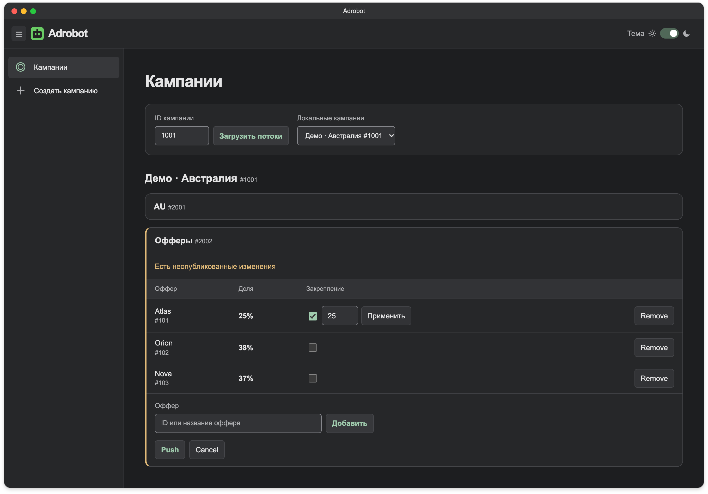

# Редактор рекламных кампаний

Приложение создаёт в Keitaro кампанию с двумя потоками. Посетители из выбранной страны переходят на Google, остальные — на выбранный оффер. Кампания включается после настройки обоих потоков.

В редакторе можно менять состав офферов и их доли. Черновик хранится в SQLite и сохраняется после обновления страницы. Кнопка **Push** публикует изменения в Keitaro.

**Стек:** FastAPI, SQLAlchemy, SQLite, React и Vite.



## Настройка

Понадобятся Python 3.11 или новее и ключ Keitaro Admin API v1 с доступом к кампаниям, потокам, офферам, доменам, группам и источникам.

Для фронтенда нужен Node.js с npm. Сборка проверена на Node.js 22.

При первом запуске скопируйте `.env.example` в `.env` в корне проекта:

- **Linux / macOS:** `cp .env.example .env`
- **Windows PowerShell:** `Copy-Item .env.example .env`

В `.env` укажите адрес трекера без `/admin` и `/admin_api/v1` и свой ключ:

```dotenv
KEITARO_URL=https://your-tracker.example
KEITARO_API_KEY=ваш_ключ
```

## Запуск

Откройте два терминала в корне проекта.

### Терминал 1 — сервер

**Linux / macOS**

```bash
cd backend
python3 -m venv .venv
.venv/bin/python -m pip install -r requirements.txt
.venv/bin/python -m alembic upgrade head
.venv/bin/python -m uvicorn main:app --host 127.0.0.1 --port 8000
```

**Windows PowerShell**

```powershell
cd backend
py -3 -m venv .venv
.\.venv\Scripts\python.exe -m pip install -r requirements.txt
.\.venv\Scripts\python.exe -m alembic upgrade head
.\.venv\Scripts\python.exe -m uvicorn main:app --host 127.0.0.1 --port 8000
```

Alembic создаёт базу `backend/adrobot.db`. После появления новых миграций повторите команду `upgrade head` из папки `backend`.

### Терминал 2 — интерфейс

**Linux / macOS**

```bash
cd frontend
npm ci
npm run dev
```

**Windows PowerShell**

```powershell
cd frontend
npm.cmd ci
npm.cmd run dev
```

Откройте адрес из вывода Vite — обычно [127.0.0.1:5173](http://127.0.0.1:5173/). При следующих запусках достаточно команд Uvicorn и Vite из соответствующих папок.

## Работа с редактором

| Действие | Результат |
| --- | --- |
| Загрузить потоки | Читает кампанию из Keitaro по ID. Оффер, убранный из потока в трекере, остаётся в локальном архиве. Если есть черновик, сначала выполните Push или Cancel. |
| Добавить | Добавляет выбранный оффер в черновик и пересчитывает доли. |
| Remove / Bring back | Убирает оффер из распределения или возвращает его. Доли пересчитываются. Последний активный оффер убрать нельзя. |
| Закрепление | Фиксирует текущую долю для будущих пересчётов. Само переключение флажка сохраняется локально и не требует Push. |
| Push | Публикует черновик одного потока. Если состав или доли изменились в Keitaro, редактор сообщит о конфликте и сохранит черновик. |
| Cancel | Отменяет неопубликованные правки потока и восстанавливает последнее опубликованное распределение. |

На скриншоте у первого оффера закреплено **25%**. После возврата третьего оффера оставшиеся 75% делятся между двумя незакреплёнными. Дополнительный процент получает оффер с меньшим ID — получается **25 / 38 / 37**.

**Если создание прервалось.** Перед повтором найдите кампанию в Keitaro по ID из сообщения или по названию и alias, если ID ещё неизвестен. Если кампания уже есть, проверьте оба потока и её состояние. Включённую кампанию можно открыть по ID кнопкой «Загрузить потоки».

**Если Push сообщил о конфликте.** Запишите нужные правки. Нажмите **Cancel**, чтобы сбросить локальный черновик, затем **Загрузить потоки**, чтобы получить актуальные данные. Внесите нужные изменения заново и нажмите **Push**.

## Проверка

| Что проверить | Linux / macOS | Windows PowerShell |
| --- | --- | --- |
| Тесты из `backend` | `.venv/bin/python -m pytest -q` | `.\.venv\Scripts\python.exe -m pytest -q` |
| Сборка из `frontend` | `npm run build` | `npm.cmd run build` |

Тесты используют временную базу SQLite и подменяют Keitaro API.
